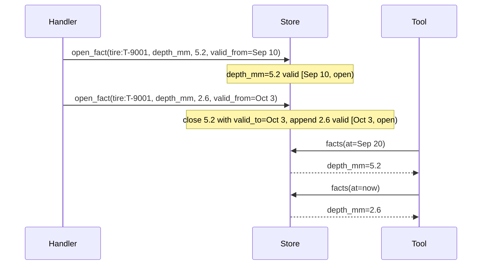
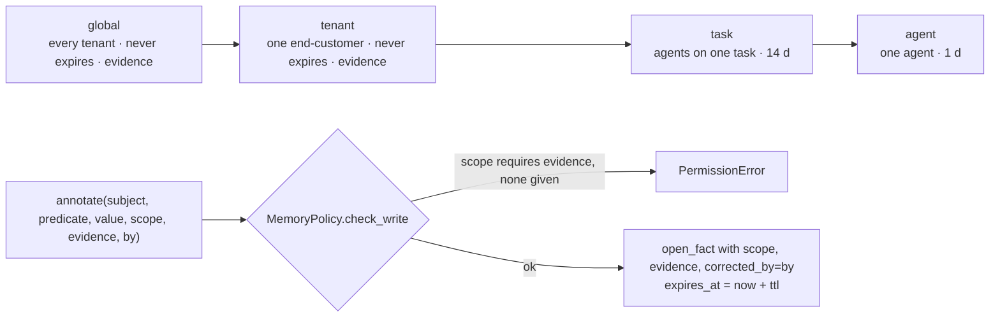

# Keel specification

Version 0.1-draft · 2026-10-14 · Status: normative for the 0.0.x line; anything marked *planned* is not implemented yet.

This document is the contract. `CLAUDE.md` says how to work on the code; `README.md` says why Keel exists. If the code and this document disagree, one of them is wrong; open an issue.

The key words MUST, MUST NOT, SHOULD and MAY are used as in RFC 2119.

---

## 1. Scope and terms

Keel is a context layer for AI agents inside a vertical SaaS. It turns **domain events** into a **bitemporal context graph** per **tenant**, declared by a **cartridge**, and exposes it to agents through **five tools**.

| Term | Meaning |
| --- | --- |
| **SaaS** | The product that runs Keel. Has its own database and its own customers. |
| **Tenant** | One end-customer of the SaaS (the tenant of the tenant). Every graph is partitioned by tenant. |
| **Event** | A fact that happened in the SaaS, with world time and source, in the standard envelope (§2). |
| **Subject** | The entity an event or fact is about, as `<kind>:<id>`. |
| **Entity** | A node in the graph: a kind, an id, a pointer (`ref`) to the system of record, and a few label attributes. |
| **Relation** | A typed, time-bounded edge between two entities. |
| **Fact** | A time-bounded (predicate, value) about a subject, with provenance. |
| **Cartridge** | The declaration of a domain: ontology, event catalog, handlers, rules, memory policy (§5). |
| **Handler** | Cartridge code that maps one event type's payload to store primitives (§4). |
| **Scope** | The sharing level of a fact: global, tenant, task, agent (§6). |
| **Tool** | One of the five operations agents use to read and write the graph (§7). |

---

## 2. Event envelope

Every event, from any adapter, MUST be an envelope with these fields.

| Field | Type | Req. | Meaning |
| --- | --- | --- | --- |
| `id` | string | no | The source's own id when it has one. Otherwise a content hash of tenant, type, subject, occurred_at, source and payload, so the same stream yields the same ids on replay and a duplicate is recognizable. Used as `evidence` on derived facts. |
| `tenant` | string | yes | Tenant key. Opaque to Keel. |
| `type` | string | yes | Dotted lowercase event type from the cartridge catalog, e.g. `inspection.created`. |
| `subject` | string | yes | `<kind>:<id>`. `kind` MUST be an entity kind declared in the cartridge. |
| `occurred_at` | datetime (tz-aware) | yes | When it happened in the world. Valid time. |
| `recorded_at` | datetime (tz-aware) | no | When Keel received it. Transaction time. Defaults to now (UTC). |
| `source` | string | yes | System of record or adapter, e.g. `fleet.vehicles`, `webhook:telematics`. |
| `payload` | object | no | Event-specific data. The core MUST NOT read it. Only handlers do. |

Rules:

- Naive datetimes MUST be rejected or coerced to UTC at the envelope; they MUST NOT reach a handler.
- `occurred_at` MAY be in the past relative to earlier events (late-arriving data). Handlers MUST use `occurred_at` as `valid_from`, never `recorded_at`.
- Envelopes are immutable. An error in an event is corrected by a later event or by an `annotate` with `corrected_by`, never by editing the log.
- Serialized form is JSON, one object per event. The reference development adapter reads one envelope per line (`.jsonl`), ignoring blank lines and lines starting with `#`.

---

## 3. Graph model

The store holds three kinds of records, each partitioned by `tenant`. There is no record that spans tenants.

### 3.1 Entity

| Field | Type | Meaning |
| --- | --- | --- |
| `tenant` | string | Partition key. |
| `kind` | string | Entity kind from the cartridge ontology. |
| `id` | string | Id within the kind. `key` = `<kind>:<id>`. |
| `ref` | string? | Pointer to the row in the system of record (`<source>#<id>` by convention). |
| `attrs` | object | Label attributes a tool needs to show the entity (plate, name). Never a copy of the row. |

`upsert_entity` creates or updates in place. Entities are not bitemporal; their history is carried by facts and relations.

### 3.2 Relation

| Field | Type | Meaning |
| --- | --- | --- |
| `tenant`, `src`, `rel`, `dst` | string | Edge from entity key `src` to entity key `dst` of type `rel`. |
| `valid_from` | datetime | World time the relation started. |
| `valid_to` | datetime? | World time it ended. `null` = open. |
| `recorded_at` | datetime | When Keel learned it. |
| `source` | string? | Provenance. |

`link` is idempotent on an open edge with the same `(src, rel, dst)`. `unlink` closes the open edge by setting `valid_to`. Edges are never deleted.

### 3.3 Fact

| Field | Type | Meaning |
| --- | --- | --- |
| `tenant`, `subject` | string | Partition and entity key. |
| `predicate` | string | What is asserted, e.g. `depth_mm`, `status`, `damage:D2`. |
| `value` | any JSON | The asserted value. |
| `valid_from` | datetime | World time the fact became true. |
| `valid_to` | datetime? | World time it stopped being true. `null` = open. |
| `recorded_at` | datetime | When Keel learned it. |
| `source` | string? | Adapter or `annotate:<by>`. |
| `scope` | enum | `global`, `tenant`, `task`, `agent` (§6). Default `tenant`. |
| `evidence` | string? | Event id, row ref, photo URL or other pointer that justifies the fact. |
| `corrected_by` | string? | A person or agent id when the fact is a correction or an annotation. |
| `expires_at` | datetime? | Memory lifetime (not world time). Set from the scope's TTL, or to the close time when its task closes. |
| `closed_at` | datetime? | Transaction time of the close: when Keel learned `valid_to`. With `recorded_at` it makes "as known at" queries possible. |
| `task` | string? | The job a task-scope annotation belongs to (`annotate(task=)`). |
| `idempotency_key` | string? | `annotate(key=)`: a retried write with the same key returns this fact. |
| `status` | string? | `null` = accepted (the truth rules and `context.facts` read); `proposed` = waiting for a decision; `rejected` = a decision, closed at once. |
| `trace` | string? | The caller's W3C `traceparent` and tool call id at write time (HTTP `traceparent` / `X-Keel-Tool-Call` headers, MCP `_meta`), so a Langfuse or LangSmith trace joins the audit export. |

**Bitemporal rule.** `open_fact(subject, predicate, value, valid_from)` MUST first close any open fact with the same `(subject, predicate)` by setting its `valid_to = valid_from`, then append the new fact. Facts are never mutated or deleted by handlers. The store MAY physically drop facts whose `expires_at` has passed (consolidation, §8).



**Queries the store MUST answer:**

- facts true **at** a world time `t`: `valid_from <= t < valid_to` (or open).
- facts **between** `since` and `until` (overlap).
- facts **as learned by** a transaction time (`recorded_at <= t`) — *planned*; the in-memory store does not filter on it yet.

**Values are for what a tool compares or shows.** A long text (a comment body, a description, a document) belongs in the system of record: store a short label or a classification as the value and the pointer as `evidence` or in the entity's `ref`, not the text itself. The graph holds pointers and semantics (design rule 2).

### 3.4 Store protocol

Writes (the only write path; handlers call these and nothing else):

```
upsert_entity(tenant, kind, id, ref=None, **attrs) -> Entity
link(tenant, src, rel, dst, valid_from, source=None) -> Relation
unlink(tenant, src, rel, dst, valid_to) -> None
open_fact(tenant, subject, predicate, value, valid_from, **provenance) -> Fact
close_fact(tenant, subject, predicate, valid_to) -> None
```

Reads:

```
entity(tenant, key) -> Entity | None
facts(tenant, subject, at=None, since=None, until=None) -> [Fact]
relations(tenant, key, rel=None, at=None) -> [Relation]
search(tenant, text) -> [Entity | Fact]
```

Ingest bookkeeping (called by the Ingestor, never by handlers): `seen(tenant, event_id)` and `remember(tenant, event_id)`, the dedupe behind at-least-once delivery; `reset` forgets them too. A store MAY offer `transaction()`, a context manager the Ingestor wraps each event or batch in. Maintenance (jobs and operators): `expire(tenant, now)`, `reset(tenant)`, `dump(tenant)` (everything about one tenant, closed facts included; `keel export` writes it as JSONL).

A store implementation MUST pass `tests/test_core.py` and `tests/test_store.py` unchanged. Run the suite against your own store with `KEEL_STORE=your_pkg.module:factory uv run pytest tests/test_store.py`, where `factory` is a zero-argument callable (or class) returning a fresh, empty store. Reference: `keel/store/memory.py` (in memory). Durable: `keel/store/sql.py` holds one plain-SQL implementation with the same filters as the reference, and `keel/store/sqlite.py` (one file, WAL) and `keel/store/mysql.py` (MySQL or MariaDB, `mysql://` URL) are its dialects; all answer identically and the conformance suite runs on SQLite and MySQL in CI. A Graphiti-backed store remains planned for graph-native queries.

---

## 4. Ingestion

The ingestor reads envelopes from an adapter and dispatches each to the handlers registered for its `type`.

- The event log is the source of truth. Keel's own copy of the log (`Ingestor.log`) is a development convenience; in production the bus holds it.
- Dispatch is **deterministic**: no network, no LLM, no randomness in the ingest path. Replaying the same log in the same order MUST produce an identical graph.
- An event with no handler is reported as unhandled; in strict mode it raises. A handler exception is reported with the event id and does not stop the stream, unless strict.
- `replay(tenant, events=None)` wipes that tenant's subgraph and re-dispatches its events from the external log given (the bus, the outbox table, a stream) or, without one, from the in-memory log. It is the recovery path, not the update path.
- Ordering: adapters SHOULD deliver events in `occurred_at` order per subject, but the result MUST NOT depend on it for facts: `open_fact` places a fact in its predicate's history by `valid_from`, closing the fact current at that instant and closing itself at the next fact's start, so a late event lands in its slot instead of closing a newer fact backwards. Relations (`link`/`unlink`) still assume order per subject.
- Transactions: when the store has them (the SQL stores do), each event is applied in one, so the handler's primitives and the dedupe mark land together (`remember` runs first, in the same transaction, and is one statement); a bulk caller passes `batch=` to commit every n events (the CLI and the HTTP batch do), and a chunk that raises in strict mode is rolled back whole and redelivered whole. A streaming adapter is never buffered.
- Batches: a store MAY offer `bulk(events)`, a context manager the Ingestor uses for chunks larger than one event. The SQL stores read the state of the chunk's subjects in a few statements, serve the handlers from memory, and write back in a few multi-row statements; the result is the same as event by event (the conformance suite checks it on every store, forwards and shuffled), about a thousand times fewer round trips.
- Duplicates: an event whose `id` the store has already applied for that tenant is skipped and counted in `IngestReport.duplicates`. With content-hash ids this makes at-least-once adapters and client retries safe; a source that can emit two identical events at the same instant MUST give them ids.

### 4.1 Adapters

An adapter is any iterable of envelopes. It MUST NOT interpret payloads.

| Adapter | Status | Notes |
| --- | --- | --- |
| JSONL file | shipped | Development and tests. |
| Postgres table + polling | shipped | `PostgresTableAdapter`: a `seq` cursor in a file, so restarts resume. At-least-once. |
| Webhook (HTTP) | shipped | `build_app`: validates the envelope, ingests, returns the report; bearer token. |
| Kafka | shipped | `KafkaAdapter` (`keel.adapters.bus`): offset committed after the handler ran. At-least-once; `dead_letter` for poison messages. |
| SQS | shipped | `SqsAdapter` (`keel.adapters.bus`): message deleted after the handler ran. Same semantics. |
| Postgres CDC | planned | |

### 4.2 Handlers

A handler is `fn(event, store) -> None`, registered for one event type with `@registry.on("<type>")`. It:

- MUST only call store primitives (§3.4).
- MUST use `event.occurred_at` for `valid_from`/`valid_to`.
- SHOULD pass `source=event.source` and `evidence=event.id` on every fact.
- MUST NOT contain business definitions (what "critical" means). Those are `rules` (§5.4).
- SHOULD be about ten lines.

---

## 5. Cartridge format

A cartridge is a directory with `cartridge.yaml` and `handlers.py`.

### 5.1 `cartridge.yaml`

```yaml
name: <slug>            # required
version: <semver>       # optional, recommended

entities:               # required: kind -> spec
  <kind>:
    description: <text>
    ref: <table.column> # optional, documents where `ref` points

relations:              # optional: rel -> {from: <kind>, to: <kind>}
  <rel>: { from: <kind>, to: <kind> }
  <rel>: { from: <kind>, to: <kind>, symmetric: true }   # recorded from either end, shown once (direction `both`)

events:                 # required: type -> spec
  <type>:
    subject: <kind>     # required: the kind of event.subject
    owner: <team>       # recommended: who owns this event's shape
    payload: { <field>: <hint>, ... }   # the notation in §5.6; `| null` = optional

rules:                  # optional: name -> definition
  <rule>:
    applies_to: <kind>  # optional; absent = applies to every subject
    definition: <text>  # human-readable, versioned with the cartridge
    <param>: <value>    # machine-readable parameters agents read
    when:               # optional: a condition the core evaluates in `context` (§5.4)
      predicate: <predicate>
      <op>: <operand>   # leaf operators in §5.4; compose with all / any / not; follow relations with via

predicates:             # optional: write policy per predicate, for annotations
  <predicate>: { multi: true }   # one open value per author (the `by`, else the agent) instead of last-writer-wins; context lists conflicts

semantic:               # optional: what `keel index` puts in each subject's document (§7.3)
  kinds: [<kind>, ...]           # absent: every kind
  predicates: [<predicate>, ...] # what to include; or exclude: [<predicate>, ...]
  attrs: true                    # entity attributes (default); false, or a list of names
  relations: [<rel>, ...]        # open relations, rendered with the other side's attributes

calendar:               # optional: business days for `open_for_business_days` (§5.4)
  weekend: [saturday, sunday]
  holidays: [2026-12-25]

agents:                 # optional: the agent registry (§6.1). Absent = no registry, any caller
  <id>:
    description: <text>
    writes: [task, agent]                        # scopes it may annotate; never global
    reads: { kinds: [<kind>, ...], relations: [<rel>, ...] }   # optional; absent = everything

memory:                 # optional; defaults in §6
  ttl:
    global: never | <n>d | <n>h | <n>m
    tenant: never | ...
    task: 14d
    agent: 1d
  requires_evidence: [global, tenant]
```

### 5.2 `handlers.py`

MUST define `registry = HandlerRegistry()` at module level with one or more `@registry.on(...)` functions.

### 5.3 Validation (`keel validate`)

A cartridge is valid when:

1. every relation's `from` and `to` are declared entity kinds;
2. every event's `subject` is a declared entity kind;
3. every cataloged event type has at least one handler;
4. every handler's event type is in the catalog;
5. every rule's `when` names a `predicate` and uses only the operators in §5.4;
6. every agent's `writes` are known scopes other than `global`, and its `reads` name declared kinds and relations.

`keel validate <cartridge> --events <stream.jsonl>` also checks every envelope in the stream against the catalog: the type is cataloged, the subject's kind is the event's `subject`, and each declared payload field is present with its declared shape (§5.6; `| null` makes it optional). It looks at payload keys and types, never at values; it is the one place the core looks at a payload at all.

### 5.4 Rules (semantic layer)

Rules are authored by product, versioned with the cartridge, and returned by the `context` tool for the subject's kind. Agents MUST read definitions from rules rather than hard-code them. The core interprets two keys: `applies_to` and `when`. `context` evaluates every applicable rule that has a `when` at `as_of` and returns `true`, `false`, or `null` (undecidable). A rule without `when` (an aggregate, a count over time) is returned as a definition only and the agent applies it.

A `when` is a condition:

- **Leaf**: `{ predicate: <p>, <op>: <operand>, ... }`. Operators on the subject's open fact for `<p>`: `lt`, `lte`, `gt`, `gte`, `eq`, `ne`, `in` (value in a list), `within_days` (a date predicate on or before `as_of + n days`, so dates already past count), `open_for_days` and `open_for_business_days` (how long the open fact has been open: a mapping of `lt`/`lte`/`gt`/`gte`/`eq`, e.g. `{ gte: 7 }`; business days skip the cartridge `calendar` weekend and holidays), `held_for_days` and `held_for_business_days` (how long the leaf's comparison has held across consecutive facts of the predicate: a waiting clock that survives a change from one waiting status to another; without a comparison, how long the predicate has had any value without a gap). `ci: true` compares strings case-insensitively. No open fact for the predicate: `null`.
- **Composition**: `{ all: [...] }`, `{ any: [...] }`, `{ not: <condition> }`. A bare list is `all`. `null` propagates unless another branch decides: a `false` in `all`, a `true` in `any`.
- **Neighbours**: `{ via: <relation>, direction: out | in | any, any: <condition> }` or `all:`. The condition is evaluated on each neighbour reached by that relation at `as_of` (`direction` defaults to `any`; symmetric relations ignore it). No neighbours: `any` is `false`, `all` is `true`. This is how an inherited state is expressed: `{ any: [ { predicate: status, eq: paused }, { via: relates_to, any: { predicate: status, eq: paused } } ] }`.

Rules see the whole tenant's graph: they are the product's semantics, not the calling agent's view, so the agent registry's read slice does not apply inside a `when`.

### 5.5 Payload notation

The `payload:` mapping of an event is a schema in a short notation. Keel checks streams against it (`keel validate --events`) and prints it as JSON Schema draft 2020-12 (`keel schema <cartridge>`), which is what SDK templates read.

| Written as | Means | JSON Schema |
| --- | --- | --- |
| `string`, `int`, `number`, `bool` | a scalar | `type` string / integer / number / boolean |
| `date`, `datetime` | an ISO 8601 string | `type: string` with `format` |
| `any` | anything | `{}` |
| `<hint> \| null` | optional and nullable | `type: [<type>, "null"]`, not in `required` |
| `string[]` (any scalar) | array of scalars | `type: array`, `items` |
| `[pending, paid]` | enum of literals | `enum` |
| `[new, done, null]` | optional enum (`null` is a literal in the list; `| null` is not YAML here) | `enum` with `null`, not in `required` |
| `[ { id: string, qty: int } ]` | array of objects | `type: array`, `items: object` |
| `{ source: string, score: number }` | nested object | `type: object`, `properties`, `required` |

Extra fields in a payload are allowed: the catalog documents what handlers need, not everything the source sends. An unknown hint is a validation error, so a typo never passes as `any`; `[string]` is rejected in favour of `string[]`.

### 5.6 The generality test

Adding or changing a cartridge MUST require no change under `keel/`. The repository keeps four cartridges (`fleet`, `crm`, `finance`, `clinics`) and all MUST pass the test suite after any core change.

---

## 6. Memory scopes and policy

| Scope | Who reads | Who writes | Default TTL | Evidence required |
| --- | --- | --- | --- | --- |
| `global` | every tenant's agents | a privileged process (cartridge rules, platform jobs) | never | yes |
| `tenant` | that tenant's agents | handlers (from events); agents/humans via `annotate` | never | yes |
| `task` | agents working the same task | agents via `annotate` | 14 days | no |
| `agent` | that agent only | that agent | 1 day | no |



Rules:

- Policy is enforced in `Tools.annotate` via `MemoryPolicy.check_write`; the calling agent is not trusted to self-police.
- A write to a scope that requires evidence without `evidence` MUST raise `PermissionError`.
- Facts written by handlers from events are `tenant` scope with `evidence = event.id`.
- Promotion to a wider scope is a new `annotate` with evidence and `by`; the narrower fact keeps its own lifetime.
- `expires_at = now + ttl` at write time; `null` when TTL is `never`. Reads MUST exclude expired facts even before a job physically removes them.

### 6.1 Agent registry

A cartridge MAY declare `agents:` (§5.1). Without it there is no registry: any caller, any scope with evidence, and an `agent` id passed to `Tools` is attribution only. With it:

- A `Tools` instance MUST be bound to a declared agent (`Tools(..., agent=<id>)`, `keel serve --agent <id>`). A missing or unknown id raises `PermissionError` at construction.
- **Writes.** `annotate` to a scope outside the agent's `writes` raises `PermissionError`. `global` is never writable by an agent. The scope policy (evidence, TTL) applies after the registry check. `source` is `annotate:<agent>`; `corrected_by` is `by` when given (a human correcting through the agent), else the agent id.
- **People.** An entry with `kind: human` is a person: it is enforced like any agent, and its annotations are signed `annotate:human:<id>` with `corrected_by = human:<id>`. Approvals are writes by a declared person, so the audit export shows who approved.
- **Reads.** `context`, `history`, `related` and `annotate` on a subject whose kind is outside `reads.kinds` raise `PermissionError`. Relations outside `reads.relations`, or whose other end is a hidden kind, are left out of `context` and `related`. `search` drops hits on hidden kinds.
- Authentication is the host's job. Keel takes the agent id as given and enforces what that id may do; it never trusts the agent to police itself (rule 5).

---

## 7. The five tools

A `Tools` instance is bound to one cartridge, one tenant and, when the cartridge declares agents, one agent (§6.1). Cross-tenant access does not exist at this layer. These five names and argument orders are part of the public standard; adding a sixth is a spec change.

### 7.1 `context(subject, as_of=None, depth=0, as_known_at=None, task=None, detail="full") -> object`

`facts` holds accepted facts only. `proposals` (present when any) holds the open proposals; `conflicts` (present when any) maps each predicate that has more than one open value to those values and their authors, which happens for `multi` predicates (§5.1) written by several agents. `detail="concise"` returns the same answer for a prompt in about a third of the tokens: `attrs`, `facts` as `{predicate: value}` (a list of `{value, by}` for a multi-valued one), `relations` as `{relation, direction, subject}`, `evaluation`, `as_of`, `watermark`, proposals and conflicts, and compact neighbours; rule definitions are left out (their names are in `evaluation`).

What is true about a subject now, or at `as_of` (world time). With `depth=1` the answer also carries `neighbors`: for each open relation (up to 50, then `neighbors_truncated: true`), the other subject's entity, open facts and rule evaluation, so one call brings a card and the cards it is linked to.

```json
{
  "subject": "unit:MXK-4821",
  "entity": { "kind": "unit", "id": "MXK-4821", "ref": "fleet.vehicles#MXK-4821", "attrs": {...} },
  "facts": [ ...open facts at now, expired excluded... ],
  "relations": [ ...open relations at now, both directions... ],
  "rules": { "<rule>": {...} },      // rules with applies_to == subject kind or absent
  "evaluation": { "<rule>": true },  // true | false | null, for the rules above that carry a `when`
  "as_of": "2026-10-14T18:41:07Z"    // now, or the `as_of` asked for
}
```

### 7.2 `history(subject=None, since=None, until=None, predicate=None, scope=None, as_known_at=None, task=None, changed_since=None) -> [Fact]`

Facts over time, oldest first, including closed ones. `predicate`, `scope` and `task` filter; `limit` keeps the most recent n, still oldest first (ask for one more to know whether more exist). `as_known_at` returns the facts as Keel knew them then (§7.6). `changed_since` keeps the facts recorded or closed after a watermark; with no `subject` it spans the tenant (subjects the caller may read), ordered by the time of the change: the "since my last run" read of an incremental agent. Each fact carries `valid_from`, `valid_to`, `recorded_at`, `closed_at`, `source`, `evidence`, `scope`, `corrected_by`, `task`.

### 7.3 `search(text="", kind=None, rule=None, limit=None, after=None) -> [Entity | Fact]`

Every entity the tools return (here, in `context.entity`, in `neighbors`, and in `keel export`) carries `key`, the `<kind>:<id>` that every other call takes and that `after` expects.

Without `kind` and `rule`: case-insensitive substring match over entity keys and attrs, and fact predicates and values. With `kind`, or `rule` (whose `applies_to` gives the kind, and which must carry a `when`): the entities of that kind matching `text`, and with `rule` only those where the rule evaluates true now, ordered by key; `limit` caps the page and `after` (the last key received) continues it. This is the work list of a sweep, a router or an orchestrator.

`mode="semantic"` ranks subjects by meaning: the query is embedded, candidates come from the deployment's vector index, and Keel then applies the tenant, the agent's read slice, `kind` and `rule`, returning entities with a `score` (default `limit` 10). Two adapter contracts make it pluggable (`keel.semantic`): `VectorIndex` (`upsert`, `delete`, `query`, `clear`, always by tenant; an index never returns another tenant's keys) and `Embedder` (`embed(texts)`). Keel ships `MemoryIndex`, `ChromaIndex` (extra `chroma`), `OpenAIEmbedder` (any `/v1/embeddings` API) and `HashEmbedder` (tests); any other is a `pkg.module:factory?param=value` spec, checked by `tests/test_semantic.py` with `KEEL_VECTOR_INDEX` / `KEEL_EMBEDDER`. The index is built by `keel index`, outside ingest (rule 10): one document per subject with its key, attributes, open accepted facts of tenant and global scope and the open relations the cartridge names, as chosen by the cartridge's `semantic:` section (§5.1); task and agent memory and proposals are never indexed; incremental from a watermark (subjects whose facts changed, and both ends of new links), `--full` rebuilds. A `rule` or `kind` filter never cuts the page: candidates are fetched in widening windows until `limit` results pass or the index runs out.

### 7.4 `annotate(subject, predicate, value, scope="task", evidence=None, by=None, task=None, key=None) -> Fact`

Writes earned memory. Applies the agent registry (§6.1) and the scope policy (§6). `source` is `annotate:<agent, or by, or 'agent'>` (`annotate:human:<id>` for a person); `corrected_by` is `by`, else the caller. `task` ties the fact to one job: `history(task=)` and `context(task=)` read it, and closing the task (`store.close_task`, `keel expire --task`) expires its memory at once. `key` makes the write idempotent, for durable-execution engines that replay steps: the same key on the same subject returns the fact it wrote; the same key with a different predicate, value, task or status raises. `status="proposed"` writes a proposal: it never touches accepted facts, waits in `context.proposals`, and needs only some write right (not the right on `scope`), so an agent can propose a tenant fact a person accepts; the evidence policy of `scope` still applies. An accepted write (no `status`) or `status="rejected"` is a decision: it needs the right on `scope` and closes the predicate's open proposals; a rejection is recorded closed at once, in `history` only. Store `close_fact` takes `status` so handlers never close proposals. Returns the stored fact including `expires_at`, `status` and `trace`.

### 7.5 `related(subject, relation=None, as_of=None) -> [{relation, direction, subject, since}]`

Open relations at now or at `as_of`, optionally filtered by type, with direction relative to the subject (`out`, `in`, or `both` for a symmetric relation, which is reported once even when the source recorded it from both ends).

### 7.6 Two time axes

`as_of` is world time: what was true then. `as_known_at` is transaction time: what Keel knew then, which is what an agent saw when it decided. A fact counts as known at `t` when `recorded_at <= t`, its close counts only when `closed_at <= t`, and memory counts when it had not expired by `t`. `context(as_known_at=t)` defaults `as_of` to `t`, and also evaluates the rules on that view; relations count when `recorded_at <= t`. Every `context` carries `watermark`, the tenant's latest transaction time, which is the cursor an agent stores for its next `history(changed_since=)`, passed back exactly as received. Every time argument of the five tools takes a datetime or ISO 8601 text, in every transport. Entities are not bitemporal and are shown as they are now. Facts written before 0.9 have no `closed_at`; their closes count as always known.

### 7.7 Transport

The tools are plain functions first. `keel serve` exposes the same five over MCP (stdio, or streamable HTTP at `/mcp` with `--transport http --tenant`) and as a JSON API (`POST /v1/<tool>`, one process for many tenants, tenant and agent from `X-Keel-Tenant` and `X-Keel-Agent` behind a shared bearer secret). The names and semantics MUST NOT change per transport.

---

## 8. Jobs

- **Expiry**: drop facts past `expires_at`, per tenant. Shipped: `store.expire(tenant)` on both stores and `keel expire <tenant> --db`; the schedule is the operator's cron. Reads exclude expired facts regardless.
- **Consolidation**: summarize old `task`/`agent` facts into a durable `tenant` fact with evidence pointing at the originals. Not designed yet; see CLAUDE.md open decisions.
- **Replay**: rebuild a tenant from the external log. Shipped: `Ingestor.replay(tenant, events=adapter)` and `keel replay <cartridge> <stream> <tenant> --db`.

---

## 9. Invariants (what a conformance test checks)

1. No record spans tenants; every read is partitioned by tenant.
2. `open_fact` never overwrites: after two writes to the same predicate, both facts exist and the first is closed at the second's `valid_from`.
3. A fact query `at=t` returns exactly the facts valid at `t`.
4. Replay produces a graph equal to the one built incrementally.
9. Ingesting the same event twice changes nothing, and ingesting the same events in any order yields the same facts.
5. `annotate` to a scope in `requires_evidence` without evidence raises.
6. `task`/`agent` annotations carry `expires_at`; `tenant`/`global` with `never` TTL do not.
7. The core imports nothing from `cartridges/`; every reference cartridge validates and passes after any core change.
8. Ingest performs no I/O other than reading the adapter and writing the store.

---

## 10. Non-goals

- Document or conversation ingestion (RAG memory). Keel can hold a pointer to such a store's output as a fact.
- Agent orchestration, planning or tool routing.
- A query language exposed to agents beyond the five tools.
- Cross-tenant analytics (do that on the SaaS's warehouse).

---

## 11. Versioning

- The envelope, the cartridge format and the five tool signatures are versioned together as the **Keel standard**; breaking changes bump the minor version while pre-1.0.
- A cartridge declares its own `version`; the core records which cartridge version built a tenant's graph (*planned*).
- Store implementations are versioned independently; all MUST pass the conformance invariants (§9).
