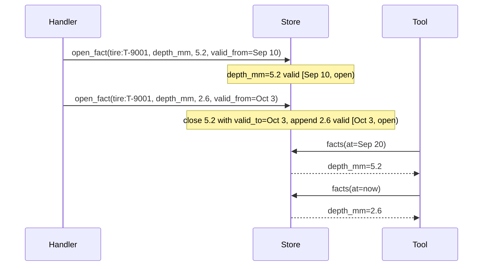
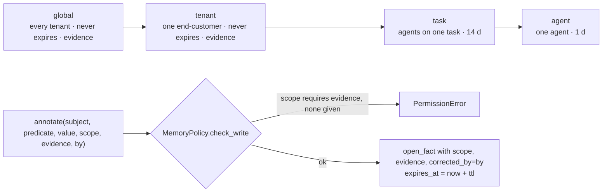

# Keel specification

Version 0.29 · 2026-10-18 · Status: normative for the 0.29.x line; anything marked *planned* is not implemented yet.

This document is the contract. `CLAUDE.md` says how to work on the code; `README.md` says why Keel exists. If the code and this document disagree, one of them is wrong; open an issue.

The key words MUST, MUST NOT, SHOULD and MAY are used as in RFC 2119.

---

## 1. Scope and terms

Keel is a context layer for the AI agents inside a product: a vertical SaaS, a consumer app, an internal tool. It turns **domain events** into a **bitemporal context graph** per **tenant**, declared by a **cartridge**, and exposes it to agents through **five tools**.

| Term | Meaning |
| --- | --- |
| **Product** | What runs Keel: a SaaS, a consumer app, an internal tool. Has its own database and its own tenants. |
| **Tenant** | The product's unit of data: one end-customer of a SaaS, a household, a team. Every graph is partitioned by tenant. |
| **Event** | A fact that happened in the product, with world time and source, in the standard envelope (§2). |
| **Subject** | The entity an event or fact is about, as `<kind>:<id>`. |
| **Entity** | A node in the graph: a kind, an id, a pointer (`ref`) to the system of record, and a few label attributes. |
| **Relation** | A typed, time-bounded edge between two entities. |
| **Fact** | A time-bounded (predicate, value) about a subject, with provenance. |
| **Cartridge** | The declaration of a domain: ontology, event catalog, handlers, rules, memory policy (§5). |
| **Handler** | Cartridge code that maps one event type's payload to store primitives (§4). |
| **Scope** | The sharing level of a fact: global, tenant, task, agent (§6). |
| **Tool** | One of the five operations agents use to read and write the graph (§7). |

---

## 2. Event envelope

Every event, from any adapter, MUST be an envelope with these fields.

| Field | Type | Req. | Meaning |
| --- | --- | --- | --- |
| `id` | string | no | The source's own id when it has one. Otherwise a content hash of tenant, type, subject, occurred_at, source and payload, so the same stream yields the same ids on replay and a duplicate is recognizable. Used as `evidence` on derived facts. |
| `tenant` | string | yes | Tenant key. Opaque to Keel. |
| `type` | string | yes | Dotted lowercase event type from the cartridge catalog, e.g. `inspection.created`. |
| `subject` | string | yes | `<kind>:<id>`. `kind` MUST be an entity kind declared in the cartridge. |
| `occurred_at` | datetime (tz-aware) | yes | When it happened in the world. Valid time. |
| `recorded_at` | datetime (tz-aware) | no | When Keel received it. Transaction time. Defaults to now (UTC). |
| `source` | string | yes | System of record or adapter, e.g. `fleet.vehicles`, `webhook:telematics`. |
| `payload` | object | no | Event-specific data. The core MUST NOT read it. Only handlers do. |

Rules:

- Naive datetimes MUST be rejected or coerced to UTC at the envelope; they MUST NOT reach a handler.
- `occurred_at` MAY be in the past relative to earlier events (late-arriving data). Handlers MUST use `occurred_at` as `valid_from`, never `recorded_at`.
- Envelopes are immutable. An error in an event is corrected by a later event or by an `annotate` with `corrected_by`, never by editing the log.
- Serialized form is JSON, one object per event. The reference development adapter reads one envelope per line (`.jsonl`), ignoring blank lines and lines starting with `#`.

---

## 3. Graph model

The store holds three kinds of records, each partitioned by `tenant`. There is no record that spans tenants.

### 3.1 Entity

| Field | Type | Meaning |
| --- | --- | --- |
| `tenant` | string | Partition key. |
| `kind` | string | Entity kind from the cartridge ontology. |
| `id` | string | Id within the kind. `key` = `<kind>:<id>`. |
| `ref` | string? | Pointer to the row in the system of record (`<source>#<id>` by convention). |
| `attrs` | object | Label attributes a tool needs to show the entity (plate, name). Never a copy of the row. |

`upsert_entity` creates or updates in place. Entities are not bitemporal; their history is carried by facts and relations.

### 3.2 Relation

| Field | Type | Meaning |
| --- | --- | --- |
| `tenant`, `src`, `rel`, `dst` | string | Edge from entity key `src` to entity key `dst` of type `rel`. |
| `valid_from` | datetime | World time the relation started. |
| `valid_to` | datetime? | World time it ended. `null` = open. |
| `recorded_at` | datetime | When Keel learned it. |
| `source` | string? | Provenance. |

`link` is idempotent on an open edge with the same `(src, rel, dst)`. `unlink` closes the open edge by setting `valid_to`. Edges are never deleted.

### 3.3 Fact

| Field | Type | Meaning |
| --- | --- | --- |
| `tenant`, `subject` | string | Partition and entity key. |
| `predicate` | string | What is asserted, e.g. `depth_mm`, `status`, `damage:D2`. |
| `value` | any JSON | The asserted value. |
| `valid_from` | datetime | World time the fact became true. |
| `valid_to` | datetime? | World time it stopped being true. `null` = open. |
| `recorded_at` | datetime | When Keel learned it. |
| `source` | string? | Adapter or `annotate:<by>`. |
| `scope` | enum | `global`, `tenant`, `task`, `agent` (§6). Default `tenant`. |
| `evidence` | string? | Event id, row ref, photo URL or other pointer that justifies the fact. |
| `corrected_by` | string? | A person or agent id when the fact is a correction or an annotation. |
| `expires_at` | datetime? | Memory lifetime (not world time). Set from the scope's TTL, or to the close time when its task closes. |
| `closed_at` | datetime? | Transaction time of the close: when Keel learned `valid_to`. With `recorded_at` it makes "as known at" queries possible. |
| `task` | string? | The job a task-scope annotation belongs to (`annotate(task=)`). |
| `idempotency_key` | string? | `annotate(key=)`: a retried write with the same key returns this fact. |
| `status` | string? | `null` = accepted (the truth rules and `context.facts` read); `proposed` = waiting for a decision; `rejected` = a decision, closed at once. |
| `trace` | string? | The caller's W3C `traceparent` and tool call id at write time (HTTP `traceparent` / `X-Keel-Tool-Call` headers, MCP `_meta`), so a Langfuse or LangSmith trace joins the audit export. |
| `cartridge` | string? | Annotations and consolidations: the cartridge they were made under, `name@version#rules` (`Cartridge.ident`; the hash covers the rules and the calendar, so a rule edited without bumping `version` still shows). To replay a decision under its rules, check out that cartridge and replay the log. Facts from events leave it empty: the event log is their record. |

**Bitemporal rule.** `open_fact(subject, predicate, value, valid_from)` MUST place the new fact in the predicate's history by `valid_from`: it closes the fact current at that instant (`valid_to = valid_from`) and, when a later fact already exists, closes itself at that fact's start. Arrival order does not change the result (§4). A predicate's history is one slot per memory scope: a fact never closes one of another scope, so a private note does not end a shared diagnosis and a promotion leaves the narrower fact to its own lifetime. Task memory has one slot per task, agent memory one per writing agent, and with `per_source=True` (multi-valued predicates and proposals) one per author. Facts are never mutated or deleted by handlers. The store MAY physically drop facts whose `expires_at` has passed (consolidation, §8).



**Queries the store MUST answer:**

- facts true **at** a world time `t`: `valid_from <= t < valid_to` (or open).
- facts **between** `since` and `until` (overlap).
- facts **as known at** a transaction time `t` (`facts(known_at=t)`): recorded by `t`, with closes counted only when `closed_at <= t` (§7.6).

**Values are for what a tool compares or shows.** A long text (a comment body, a description, a document) belongs in the system of record: store a short label or a classification as the value and the pointer as `evidence` or in the entity's `ref`, not the text itself. The graph holds pointers and semantics (design rule 2).

### 3.4 Store protocol

Writes (the only write path; handlers call these and nothing else):

```
upsert_entity(tenant, kind, id, ref=None, **attrs) -> Entity
link(tenant, src, rel, dst, valid_from, source=None) -> Relation
unlink(tenant, src, rel, dst, valid_to) -> None
open_fact(tenant, subject, predicate, value, valid_from, **provenance) -> Fact
close_fact(tenant, subject, predicate, valid_to, status=None, scope="tenant") -> None
    # status: only proposals, or only rejections; scope: only that scope's facts (None: every scope).
    # The tenant default is what a handler means: it never closes agent or task memory.
```

`open_fact` provenance keywords: `source`, `scope`, `evidence`, `corrected_by`, `expires_at`, `recorded_at`, `task`, `idempotency_key`, `status`, `trace`, `cartridge`, and `per_source` (one history per author, §3.3). A store MUST reject a second fact with the same `idempotency_key` on a subject by raising `DuplicateKey` (carrying the fact already written), atomically, so two writers racing on one key write once; the SQL stores do it with a unique index.

Reads:

```
entity(tenant, key) -> Entity | None
facts(tenant, subject, at=None, since=None, until=None, known_at=None) -> [Fact]
entities(tenant, kind=None) -> [Entity]
relations(tenant, key, rel=None, at=None) -> [Relation]
search(tenant, text) -> [Entity | Fact]
changes(tenant, after) -> [Fact]               # recorded or closed after a watermark, oldest change first
watermark(tenant) -> datetime | None           # optional: latest recorded_at or closed_at
relation_changes(tenant, after) -> [Relation]  # optional: links recorded after a watermark (keel index)
facts_of(tenant, subjects, **filters) -> {subject: [Fact]}   # optional: facts() for many subjects at once
entities_of(tenant, keys) -> {key: Entity | None}           # optional: entity() for many keys at once
relations_of(tenant, keys, at=None) -> {key: [Relation]}    # optional: relations() for many keys at once
```

`Tools` calls `entities` and `changes` on every store. `known_at` is passed only when a caller asks for transaction time, so a store without it still serves every other read. Global-scope memory is stored under the reserved tenant `__global__`, or `<account>/__global__` for a tenant `<account>/<t>` (§6); a store needs nothing special for it. API keys (optional, for the HTTP transport): `put_key(ApiKey)`, `api_key(sha256) -> ApiKey | None`, `api_keys(account=None) -> [ApiKey]` and `revoke_key(id, at) -> bool`; they are not tenant data, so `forget` and `reset` leave them. Accounts (optional, for the HTTP transport's quotas): `put_account(Account)` (insert or replace), `account(id) -> Account | None` and `accounts() -> [Account]`, with `rps`, `events_month`, `store` and `retention`. Metering (optional): `meter([(tenant, day, item, n)])` adds to daily counters and `usage(since, until) -> [(tenant, day, item, n)]` reads them; the Ingestor meters `events` applied for the first time after each commit (never on `replay`), and `Tools(meter=)` counts each tool call.

Ingest bookkeeping (called by the Ingestor, never by handlers): `seen(tenant, event_id)` and `remember(tenant, event_id)`, the dedupe behind at-least-once delivery; `reset` forgets them too. A store MAY offer `transaction()`, a context manager the Ingestor wraps each event or batch in. Maintenance (jobs and operators): `expire(tenant, now)`, `close_task(tenant, task, now)` (expires a task's memory at once), `reset(tenant)`, `dump(tenant)` (everything about one tenant, closed facts included; `keel export` writes it as JSONL), and, optionally, `tenants()` (every tenant with something stored, never a global partition; `--all-tenants` on the jobs). Erasure, optional but required by the Ingestor when the cartridge declares an event that `forgets: tenant`: `forget(tenant) -> {entities, relations, facts, annotations, ingested}` deletes, in one transaction, everything stored for the tenant (facts of every scope, annotations, dedupe marks) and leaves a tombstone (the tenant and the time); it is idempotent, keeps the first tombstone's time and refuses a global partition. `forgotten(tenant) -> datetime | None` reads the tombstone and `forgotten_tenants() -> {tenant: datetime}` lists them. Retention, optional but required by the Ingestor when the cartridge declares an event that `forgets: before`: `forget_before(tenant, before) -> {facts, annotations, relations}` deletes, in one transaction, the tenant's facts (annotations included) and relations with `valid_to <= before`, keeps open ones and entities, and keeps the cutoff (the latest wins); it is idempotent and refuses a global partition. `cutoff(tenant) -> datetime | None` reads it.

A store implementation MUST pass `tests/test_core.py` and `tests/test_store.py` unchanged. Run the suite against your own store with `KEEL_STORE=your_pkg.module:factory uv run pytest tests/test_store.py`, where `factory` is a zero-argument callable (or class) returning a fresh, empty store. Reference: `keel/store/memory.py` (in memory). Durable: `keel/store/sql.py` holds one plain-SQL implementation with the same filters as the reference, and `keel/store/sqlite.py` (one file, WAL) and `keel/store/mysql.py` (MySQL or MariaDB, `mysql://` URL) are its dialects; all answer identically and the conformance suite runs on SQLite and MySQL in CI. A Graphiti-backed store remains planned for graph-native queries.

---

## 4. Ingestion

The ingestor reads envelopes from an adapter and dispatches each to the handlers registered for its `type`.

- The event log is the source of truth. Keel's own copy of the log (`Ingestor.log`, opt-in with `keep_log=True`) is a development convenience that grows with every event; in production the bus holds it.
- Dispatch is **deterministic**: no network, no LLM, no randomness in the ingest path. Replaying the same log in the same order MUST produce an identical graph.
- An event with no handler is reported as unhandled; in strict mode it raises. A handler exception is reported with the event id and does not stop the stream, unless strict.
- `replay(tenant, events=None)` wipes that tenant's event-derived subgraph (entities, relations, facts from handlers, dedupe marks) and re-dispatches its events from the external log given (the bus, the outbox table, a stream) or, without one, from the in-memory log (only kept with `Ingestor(..., keep_log=True)`; otherwise replay without `events` is an error). It keeps annotations (facts whose `source` is `annotate:...` or `consolidate:...`, closed history included): they are earned memory, not in the log, and the events land around them as they did the first time (a store's `reset(tenant, keep_annotations=True)`). It is the recovery path, not the update path.
- Ordering: adapters SHOULD deliver events in `occurred_at` order per subject, but the result MUST NOT depend on it for facts: `open_fact` places a fact in its predicate's history by `valid_from`, closing the fact current at that instant and closing itself at the next fact's start, so a late event lands in its slot instead of closing a newer fact backwards. Relations (`link`/`unlink`) still assume order per subject.
- Transactions: when the store has them (the SQL stores do), each event is applied in one, so the handler's primitives and the dedupe mark land together (`remember` runs first, in the same transaction, and is one statement); a bulk caller passes `batch=` to commit every n events (the CLI and the HTTP batch do), and a chunk that raises in strict mode is rolled back whole and redelivered whole. A streaming adapter is never buffered.
- Batches: a store MAY offer `bulk(events)`, a context manager the Ingestor uses for chunks larger than one event. The SQL stores read the state of the chunk's subjects in a few statements, serve the handlers from memory, and write back in a few multi-row statements; the result is the same as event by event (the conformance suite checks it on every store, forwards and shuffled), about a thousand times fewer round trips.
- Batch reads: a store MAY offer `facts_of`, `entities_of` and `relations_of`, the same answers as `facts` and `entity` for many subjects. `context(depth=1)` reads its neighbours with them, `search(rule=)` its candidates in chunks, and a rule that follows a relation its neighbours: a few statements whatever the neighbourhood's size, where one per subject would be a round trip each on a networked database. Without them Tools reads one subject at a time.
- Threads: a store shared by a server's threads MUST keep a transaction, its read cache and a batch in flight to the thread that opened them: another thread waits for it or reads committed state, and never writes into it (a write that joined a batch would be lost with its rollback). The MySQL store reads on one connection per thread, so reads never queue behind a writer.
- Erasure: an event whose type the cartridge declares `forgets: tenant` runs no handler; the Ingestor calls `store.forget(tenant)` in that event's transaction (a chunk holding one is applied event by event, never through `bulk`) and lists what was deleted in `IngestReport.forgotten`. Every later event for a forgotten tenant, a late redelivery included, is skipped without being applied and counted in `IngestReport.skipped`, so nothing revives it, and a replay of it yields nothing. Keel deletes only what it stores: the external log (the bus, the outbox table) belongs to the product, and global memory (§6) is every tenant's and is kept.
- Retention: an event whose type the cartridge declares `forgets: before` runs no handler; the Ingestor marks it applied and calls `store.forget_before(tenant, event.occurred_at)` in its transaction (never through `bulk`), listing the cutoff and what was deleted in `IngestReport.retained`. `replay` applies the tenant's kept cutoff again after rebuilding. Events are not skipped by the cutoff: one arriving later with an earlier valid time stays until the next retention run.
- Duplicates: an event whose `id` the store has already applied for that tenant is skipped and counted in `IngestReport.duplicates`. With content-hash ids this makes at-least-once adapters and client retries safe; a source that can emit two identical events at the same instant MUST give them ids.

### 4.1 Adapters

An adapter is any iterable of envelopes. It MUST NOT interpret payloads.

| Adapter | Status | Notes |
| --- | --- | --- |
| JSONL file | shipped | Development and tests. |
| Postgres table + polling | shipped | `PostgresTableAdapter`: a `seq` cursor in a file, so restarts resume; it moves only after the Ingestor commits (`ack()`). At-least-once. |
| Webhook (HTTP) | shipped | `build_app`: validates the envelope, ingests, returns the report; bearer token. |
| HTTP API and typed SDKs | shipped | `POST /v1/events` on `keel serve --transport http`, called directly or through `events()` in the generated clients (§7.7); one envelope or a list, the ingest report back. |
| Kafka | shipped | `KafkaAdapter` (`keel.adapters.bus`): offset committed after the Ingestor commits the batch (`ack()`). At-least-once; `dead_letter` for poison messages. |
| SQS | shipped | `SqsAdapter` (`keel.adapters.bus`): message deleted after the Ingestor commits the batch (`ack()`). Same semantics. `keel consume --queue <url>` runs it, a batch per transaction (`--batch`, default 100), retried one message at a time when it fails; a failed message stays for the queue's dead-letter queue, and a store that stops answering ends the process (exit 2). |
| Postgres CDC | shipped | `PostgresCdcAdapter`, `keel cdc`: logical replication with `pgoutput` read through SQL functions; each mapped row change is `<kind>.created|updated|deleted`, id `pgcdc:<commit lsn>:<n>`; the slot advances only after the store commits. |

### 4.2 Handlers

A handler is `fn(event, store) -> None`, registered for one event type with `@registry.on("<type>")`. It:

- MUST only call store primitives (§3.4).
- MUST use `event.occurred_at` for `valid_from`/`valid_to`.
- SHOULD pass `source=event.source` and `evidence=event.id` on every fact.
- MUST NOT contain business definitions (what "critical" means). Those are `rules` (§5.4).
- SHOULD be about ten lines.

---

## 5. Cartridge format

A cartridge is a directory with `cartridge.yaml` and `handlers.py`.

### 5.1 `cartridge.yaml`

```yaml
name: <slug>            # required
version: <semver>       # optional, recommended

entities:               # required: kind -> spec
  <kind>:
    description: <text>
    ref: <table.column> # optional, documents where `ref` points

relations:              # optional: rel -> {from: <kind>, to: <kind>}
  <rel>: { from: <kind>, to: <kind> }
  <rel>: { from: <kind>, to: <kind>, symmetric: true }   # recorded from either end, shown once (direction `both`)

events:                 # required: type -> spec
  <type>:
    subject: <kind>     # required: the kind of event.subject
    owner: <team>       # recommended: who owns this event's shape
    payload: { <field>: <hint>, ... }   # the notation in §5.5; `| null` = optional
    forgets: tenant     # optional: this event erases its tenant (§4), or `before`: deletes what closed before it; it takes no handler

rules:                  # optional: name -> definition
  <rule>:
    applies_to: <kind>  # optional; absent = applies to every subject
    definition: <text>  # human-readable, versioned with the cartridge
    <param>: <value>    # machine-readable parameters agents read
    when:               # optional: a condition the core evaluates in `context` (§5.4)
      predicate: <predicate>
      <op>: <operand>   # leaf operators in §5.4; compose with all / any / not; follow relations with via

predicates:             # optional: write policy per predicate, for annotations
  <predicate>: { multi: true, description: <text> }   # multi: one open value per author (the `by`, else the agent) instead of last-writer-wins; context lists conflicts

semantic:               # optional: what `keel index` puts in each subject's document (§7.3)
  kinds: [<kind>, ...]           # absent: every kind
  predicates: [<predicate>, ...] # what to include; or exclude: [<predicate>, ...]
  attrs: true                    # entity attributes (default); false, or a list of names
  relations: [<rel>, ...]        # open relations: the other side's key and one label
  labels: [name, nombre]         # the attribute that labels the other side (first present wins); default: name, nombre, title, titulo, label, plate, model
  lexical_weight: 0.3            # hybrid search: weight of the lexical leg (0 = dense only)
  min_score: 0.4                 # optional cosine floor; model-specific, calibrate with evals/semantic
  split: { <kind>: [<predicate>, ...] }  # also one document per open fact of these predicates, and per element of a list value (each field of a visual), not only one per subject

consolidate:            # optional: episodic memory summarized into durable facts (§8)
  <name>:
    from: { predicate: <p>, scopes: [task] }   # default [task]; agent memory is read only when listed
    applies_to: <kind>             # optional
    within: 30d                    # optional window on valid_from (world time)
    min_count: 3                   # default 2
    reduce: mode                   # mode | latest | count | min | max | avg | distinct | summary
    into: { predicate: <q>, scope: tenant }

calendar:               # optional: business days for `open_for_business_days` (§5.4)
  weekend: [saturday, sunday]
  holidays: [2026-12-25]

agents:                 # optional: the agent registry (§6.1). Absent = no registry, any caller
  <id>:
    description: <text>
    kind: agent                                  # or human: a person, signed human:<id> (§6.1)
    writes: [task, agent]                        # scopes it may annotate; never global; absent = [task, agent]
    reads: { kinds: [<kind>, ...], relations: [<rel>, ...] }   # optional; absent = everything

memory:                 # optional; defaults in §6
  ttl:
    global: never | forever | <n>d | <n>h | <n>m | <n>   # a bare number is days
    tenant: never | ...
    task: 14d
    agent: 1d
  requires_evidence: [global, tenant]
```

### 5.2 `handlers.py`

MUST define `registry = HandlerRegistry()` at module level with one or more `@registry.on(...)` functions.

### 5.3 Validation (`keel validate`)

A cartridge is valid when:

1. every relation's `from` and `to` are declared entity kinds;
2. every event's `subject` is a declared entity kind;
3. every cataloged event type has at least one handler, except one that `forgets`, which has none (`forgets` takes `tenant` or `before`);
4. every handler's event type is in the catalog;
5. every rule's `when` names a `predicate` and uses only the operators in §5.4;
6. every agent's `kind` is `agent` or `human`, its `writes` are known scopes other than `global`, and its `reads` name declared kinds and relations;
7. every event's payload hints use the notation in §5.5;
8. `predicates`, `semantic` and `consolidate` use only known keys, with values in range (a weight between 0 and 1, a known reducer, a known scope);
9. every `via` names a declared relation with a valid `direction`, and duration operators (`open_for_*`, `held_for_*`) take a comparison mapping.

`keel validate <cartridge> --events <stream.jsonl>` also checks every envelope in the stream against the catalog: the type is cataloged, the subject's kind is the event's `subject`, and each declared payload field is present with its declared shape (§5.5; `| null` makes it optional). It looks at payload keys and types, never at values; it is the one place the core looks at a payload at all.

### 5.4 Rules (semantic layer)

Rules are authored by product, versioned with the cartridge, and returned by the `context` tool for the subject's kind. Agents MUST read definitions from rules rather than hard-code them. The core interprets two keys: `applies_to` and `when`. `context` evaluates every applicable rule that has a `when` at `as_of` and returns `true`, `false`, or `null` (undecidable). A rule without `when` (an aggregate, a count over time) is returned as a definition only and the agent applies it.

A `when` is a condition:

- **Leaf**: `{ predicate: <p>, <op>: <operand>, ... }`. Operators on the subject's open fact for `<p>`: `lt`, `lte`, `gt`, `gte`, `eq`, `ne`, `in` (value in a list), `within_days` (a date predicate on or before `as_of + n days`, so dates already past count), `open_for_days` and `open_for_business_days` (how long the open fact has been open: a mapping of `lt`/`lte`/`gt`/`gte`/`eq`, e.g. `{ gte: 7 }`; business days skip the cartridge `calendar` weekend and holidays), `held_for_days` and `held_for_business_days` (how long the leaf's comparison has held across consecutive facts of the predicate: a waiting clock that survives a change from one waiting status to another; without a comparison, how long the predicate has had any value without a gap). `ci: true` compares strings case-insensitively. No open fact for the predicate: `null`.
- **Composition**: `{ all: [...] }`, `{ any: [...] }`, `{ not: <condition> }`. A bare list is `all`. `null` propagates unless another branch decides: a `false` in `all`, a `true` in `any`.
- **Neighbours**: `{ via: <relation>, direction: out | in | any, any: <condition> }` or `all:`. The condition is evaluated on each neighbour reached by that relation at `as_of` (`direction` defaults to `any`; symmetric relations ignore it). No neighbours: `any` is `false`, `all` is `true`. This is how an inherited state is expressed: `{ any: [ { predicate: status, eq: paused }, { via: relates_to, any: { predicate: status, eq: paused } } ] }`.

Rules see the whole tenant's graph: they are the product's semantics, not the calling agent's view, so the agent registry's read slice does not apply inside a `when`.

### 5.5 Payload notation

The `payload:` mapping of an event is a schema in a short notation. Keel checks streams against it (`keel validate --events`) and prints it as JSON Schema draft 2020-12 (`keel schema <cartridge>`), which is what SDK templates read.

| Written as | Means | JSON Schema |
| --- | --- | --- |
| `string`, `int`, `number`, `bool` | a scalar | `type` string / integer / number / boolean |
| `date`, `datetime` | an ISO 8601 string | `type: string` with `format` |
| `any` | anything | `{}` |
| `<hint> \| null` | optional and nullable | `type: [<type>, "null"]`, not in `required` |
| `string[]` (any scalar) | array of scalars | `type: array`, `items` |
| `[pending, paid]` | enum of literals | `enum` |
| `[new, done, null]` | optional enum (`null` is a literal in the list; `| null` is not YAML here) | `enum` with `null`, not in `required` |
| `[ { id: string, qty: int } ]` | array of objects | `type: array`, `items: object` |
| `{ source: string, score: number }` | nested object | `type: object`, `properties`, `required` |

Extra fields in a payload are allowed: the catalog documents what handlers need, not everything the source sends. An unknown hint is a validation error, so a typo never passes as `any`; `[string]` is rejected in favour of `string[]`.

### 5.6 The generality test

Adding or changing a cartridge MUST require no change under `keel/`. The repository keeps four cartridges (`fleet`, `crm`, `finance`, `clinics`) and all MUST pass the test suite after any core change.

---

## 6. Memory scopes and policy

| Scope | Who reads | Who writes | Default TTL | Evidence required |
| --- | --- | --- | --- | --- |
| `global` | every tenant's agents | a privileged process (a `Tools` bound to no registry agent; never an agent, never an event) | never | yes |
| `tenant` | that tenant's agents | handlers (from events); agents/humans via `annotate` | never | yes |
| `task` | calls that pass the fact's task (`context(task=)`, `history(task=)`); a task fact with no task id is the tenant's | agents via `annotate` | 14 days | no |
| `agent` | the agent that wrote it (a `Tools` bound to no agent id reads none) | that agent | 1 day | no |



Rules:

- Policy is enforced in `Tools.annotate` via `MemoryPolicy.check_write`; the calling agent is not trusted to self-police.
- A write to a scope that requires evidence without `evidence` MUST raise `PermissionError`.
- Facts written by handlers from events are `tenant` scope with `evidence = event.id`.
- Promotion to a wider scope is a new `annotate` with evidence and `by`; the narrower fact keeps its own lifetime.
- `expires_at = now + ttl` at write time; `null` when TTL is `never`. Reads MUST exclude expired facts even before a job physically removes them.
- Reads are enforced in `Tools`, on every path that returns facts (`context` and its neighbours, rule evaluation, `history` with or without a subject, text `search`): an `agent` fact is returned only to a caller bound to its author (its `source` is `annotate:<author>`); a `task` fact tied to a task only to calls passing that task; a `task` fact with no task id to the whole tenant. Rules evaluate on the same view, so another agent's or another task's memory never decides a verdict.
- Global memory lives in the reserved partition `__global__`: `annotate(scope="global")` writes there and every tenant's reads merge it, so one fact is seen by every tenant. No event may carry that tenant and no `Tools` may be bound to it. It is the one deliberate exception to invariant 1, and it holds only what a privileged process wrote. A tenant whose name has an account prefix (`acme/t`, given by the HTTP transport's API keys) reads and writes `acme/__global__` instead, which no other account sees; over HTTP only the account's global key writes it.

### 6.1 Agent registry

A cartridge MAY declare `agents:` (§5.1). Without it there is no registry: any caller, any scope with evidence, and an `agent` id passed to `Tools` is attribution only. With it:

- A `Tools` instance MUST be bound to a declared agent (`Tools(..., agent=<id>)`, `keel serve --agent <id>`). A missing or unknown id raises `PermissionError` at construction.
- **Writes.** `annotate` to a scope outside the agent's `writes` raises `PermissionError`. `global` is never writable by an agent. The scope policy (evidence, TTL) applies after the registry check. `source` is `annotate:<agent>`; `corrected_by` is `by` when given (a human correcting through the agent), else the agent id.
- **People.** An entry with `kind: human` is a person: it is enforced like any agent, and its annotations are signed `annotate:human:<id>` with `corrected_by = human:<id>`. Approvals are writes by a declared person, so the audit export shows who approved.
- **Reads.** `context`, `history`, `related` and `annotate` on a subject whose kind is outside `reads.kinds` raise `PermissionError`. Relations outside `reads.relations`, or whose other end is a hidden kind, are left out of `context` and `related`. `search` drops hits on hidden kinds.
- Authentication is the host's job. Keel takes the agent id as given and enforces what that id may do; it never trusts the agent to police itself (rule 5).

---

## 7. The five tools

A `Tools` instance is bound to one cartridge, one tenant and, when the cartridge declares agents, one agent (§6.1). Cross-tenant access does not exist at this layer. These five names and argument orders are part of the public standard; adding a sixth is a spec change.

### 7.1 `context(subject, as_of=None, depth=0, as_known_at=None, task=None, detail="full", exclude=None, only=None) -> object`

`subject` may be a list: the answers come back in order, one per subject, in one call. `exclude` (a list of predicates) leaves those predicates out of `facts`, `proposals` and the neighbours' facts, for an evaluation in which the agent must not see the answer; rules still evaluate on the whole truth, so a verdict can reveal it. `only` (a non-empty list of predicates) is the opposite: just those predicates, in the same places, for the evidence a reviewer checks across many subjects without the rest of their facts; `exclude` still hides what it names. A list of subjects is read in a few statements (facts, proposals, relations and entities in batches), not one or more per subject. A `search` with a list of texts shares those reads too: each subject's facts are read once for every text, so checking many names against one subject's neighbours (`search(names, kind=[...], related_to=s)`) is one call.

`facts` holds accepted facts only. `proposals` (present when any) holds the open proposals; `conflicts` (present when any) maps each predicate that has more than one open value to those values and their authors, which happens for `multi` predicates (§5.1) written by several agents. `detail="concise"` returns the same answer for a prompt in about a third of the tokens: `attrs`, `facts` as `{predicate: value}` (a list of `{value, by}` for a multi-valued one), `relations` as `{relation, direction, subject}` (direction `both` for a symmetric relation, as everywhere else), `evaluation`, `as_of`, `watermark`, proposals and conflicts, and compact neighbours; rule definitions are left out (their names are in `evaluation`).

What is true about a subject now, or at `as_of` (world time). `detail="brief"` (the cheapest, for an agent) is `concise` with relations grouped as `{relation: [subjects]}`, an incoming one written `<-relation`. Relations are listed up to 10 per relation and direction, the most recent ones; past that, `relations_more` gives each one's `relation`, `direction`, `shown` and `total`, and `related` or `search(related_to=...)` reads the rest, so an account with hundreds of tickets does not put all of them in every answer. With `depth=1` the answer also carries `neighbors`: for each open relation (up to 50, then `neighbors_truncated: true`), the other subject's entity, open facts and rule evaluation, so one call brings a card and the cards it is linked to.

```json
{
  "subject": "unit:MXK-4821",
  "entity": { "kind": "unit", "id": "MXK-4821", "ref": "fleet.vehicles#MXK-4821", "attrs": {...} },
  "facts": [ ...open facts at now, expired excluded... ],
  "relations": [ ...open relations at now, both directions... ],
  "rules": { "<rule>": {...} },      // rules with applies_to == subject kind or absent
  "evaluation": { "<rule>": true },  // true | false | null, for the rules above that carry a `when`
  "as_of": "2026-10-14T18:41:07Z"    // now, or the `as_of` asked for
}
```

### 7.2 `history(subject=None, since=None, until=None, predicate=None, scope=None, as_known_at=None, task=None, changed_since=None, limit=None) -> [Fact]`

Facts over time, oldest first, including closed ones. `predicate`, `scope` and `task` filter (`task` returns only what that task wrote; without it, task memory tied to a task is not returned, §6); `limit` keeps the most recent n, still oldest first (ask for one more to know whether more exist). `as_known_at` returns the facts as Keel knew them then (§7.6). `changed_since` keeps the facts recorded or closed after a watermark; with no `subject` it spans the tenant (subjects the caller may read), ordered by the time of the change: the "since my last run" read of an incremental agent. Each fact carries `valid_from`, `valid_to`, `recorded_at`, `closed_at`, `source`, `evidence`, `scope`, `corrected_by`, `task`.

### 7.3 `search(text="", kind=None (or a list), rule=None, limit=None, after=None, mode="text", min_score=None, related_to=None, via=None, detail="entity", depth=0, per_kind=None, exclude=None, as_of=None, where=None) -> [Entity | Fact]`

What each entity result carries (`detail="brief"`, for an agent: the key, attrs, score and current facts as `{predicate: value}`, without tenant, kind, id or ref, which the key carries): `detail="key"` only the keys, as strings (a fact hit gives its subject; each key once; not with `depth`), the cheapest listing; `detail="entity"` (the default) the entity; `"concise"` also its current facts as `{predicate: value}`, `"full"` as facts, so a result needs no `context` call to be understood. `depth=1` adds `neighbors` (relation, direction, subject, and their facts when `detail` asks for them; up to 50, then `neighbors_truncated`). Facts and neighbours of a page are read in a few statements whatever its size. `per_kind=n` returns the best `n` of every kind instead of one ranking (in semantic mode one ranking per kind, `rule` or `kind` narrowing the kinds; in text mode the text ranking cut per kind; not with `after`): with `related_to` for the scope, `mode="semantic"` and `detail="concise"`, the context a task needs in one call. `exclude` leaves predicates out of what is returned and drops fact hits on them. `as_of` evaluates `rule`, walks `related_to` and reads the facts and neighbours at that instant (entities are not bitemporal; the semantic index is as of its last `keel index`). `text` may be a list: one result list per text, in order. `kind` may be a list: the listing covers those kinds, ordered by key (`after` is then a full key), a semantic ranking only them, and `per_kind` the best `n` of each (in text mode, the first `n` of each listing; one kind with `per_kind` in text mode is an error, that is `limit`).

`where={name: value}` keeps the entities whose attribute `name`, or current accepted fact `name` (at `as_of`), is `value`, or a list holding it; strings compare without case, and the whole value, not a part of it: `search(kind="visual", where={"title": "Detalhe Ociosidade"})` finds a visual by its exact title, which a semantic search blurs. It applies in every mode, after the other filters; a name that `exclude` hides is an error. Each ranked entity says why it is a result: `matched` is the attribute or predicate whose value matched (or `"key"`), and `snippet` the part of that value around the match (up to 160 characters; of a list, the element). In text mode that is the substring; in semantic mode, the split document that ranked it (below) or else the field sharing most words with the query; nothing when no field does, and never a hidden predicate. A listing without `text` carries neither.

`related_to` (a subject key the caller may read) keeps only that subject's current neighbours, through relation `via` when given, in every mode: `search(kind="card", rule="en_pausa", related_to="cliente:BAT", via="de_cliente")` is the paused cards of one client in one call, walking the client's neighbours rather than the whole kind. `after` has one format, the key of the last entity received (`tire:T-9002`); an id alone is accepted when the listing has one kind. It pages the `kind`/`rule` listing only: with `mode="semantic"` or a plain text search it is an error, since those rank and page with `limit`.

Every entity the tools return (here, in `context.entity`, in `neighbors`, and in `keel export`) carries `key`, the `<kind>:<id>` that every other call takes and that `after` expects.

Without `kind` and `rule`: case-insensitive substring match over entity keys and attrs, and fact predicates and values. With `kind`, or `rule` (whose `applies_to` gives the kind, and which must carry a `when`): the entities of that kind whose key, attrs or current facts' values match `text` (since 0.20; before, key and attrs only), and with `rule` only those where the rule evaluates true now, ordered by key; `limit` caps the page and `after` (the last key received) continues it. This is the work list of a sweep, a router or an orchestrator.

`mode="semantic"` ranks subjects by meaning: subjects whose id appears verbatim in the query come first (`match: "key"`, score 1); then a dense leg (the embedded query against the vector index) and, when the index offers `text_query`, a lexical leg (BM25 over the same documents) are fused by a convex combination of min-max normalized scores, weighted by the cartridge's `semantic.lexical_weight` (default 0.3; 0 is dense only); then the optional reranker reorders the top candidates. The tenant, the agent's read slice, `kind` and `rule` always apply, inside the index when its `query` takes `where`; with `related_to`, `where` also carries `subject` (the neighbours' keys; a split document belongs to its subject), which an index MAY apply and Keel checks after retrieval either way. Each entity carries `score` and `similarity` (the cosine); `min_score` (or the cartridge's `semantic.min_score`) drops results below that cosine, and is model-specific. Default `limit` 10. Three adapter contracts make it pluggable (`keel.semantic`): `VectorIndex` (`upsert`, `delete`, `query`, `clear`, always by tenant, an index never returns another tenant's keys; optional `where` on `query` and an optional `text_query`), `Embedder` (`embed(texts)`, optionally `role="query"|"document"` for asymmetric models) and `Reranker` (`rerank(query, docs)`; bundled: the Cohere/Jina/Voyage `/rerank` shape and an LLM reranker over any `/chat/completions`). Keel ships `MemoryIndex`, `ChromaIndex` (extra `chroma`), `WeaviateIndex` (extra `weaviate`), `OpenAIEmbedder` (any `/v1/embeddings` API) and `HashEmbedder` (tests); any other is a `pkg.module:factory?param=value` spec, checked by `tests/test_semantic.py` with `KEEL_VECTOR_INDEX` / `KEEL_EMBEDDER`. The index is built by `keel index`, outside ingest (rule 10): one document per subject with its key, attributes, open accepted facts of tenant and global scope and the open relations the cartridge names, as chosen by the cartridge's `semantic:` section (§5.1); task and agent memory and proposals are never indexed; with `semantic.split`, each open fact of the listed predicates is also a document of its own (a list value, one per element), a hit on it ranks its subject (which keeps its best document, and says which predicate in `matched` and which value or element in `snippet`), and a changed value replaces its document; incremental from a watermark (subjects whose facts changed, and both ends of new links), `--full` rebuilds. A `rule` or `kind` filter never cuts the page: candidates are fetched in widening windows until `limit` results pass or the index runs out.

### 7.4 `annotate(subject, predicate, value, scope="task", evidence=None, by=None, task=None, key=None, status=None) -> Fact`

Writes earned memory. Applies the agent registry (§6.1) and the scope policy (§6); refused for a forgotten tenant (§4). `source` is `annotate:<agent, or by, or 'agent'>` (`annotate:human:<id>` for a person); `corrected_by` is `by`, else the caller. `task` ties the fact to one job: `history(task=)` and `context(task=)` read it, and closing the task (`store.close_task`, `keel expire --task`) expires its memory at once. `key` makes the write idempotent, for durable-execution engines that replay steps: the same key on the same subject returns the fact it wrote; the same key with a different predicate, value, task or status raises. `status="proposed"` writes a proposal: it never touches accepted facts, waits in `context.proposals`, and needs only some write right (not the right on `scope`), so an agent can propose a tenant fact a person accepts; the evidence policy of `scope` still applies. An accepted write (no `status`) or `status="rejected"` is a decision: it needs the right on `scope` and closes the predicate's open proposals; a rejection is recorded closed at once, in `history` only. Proposals are kept one open per author per predicate, in their own history beside the accepted facts. Store `close_fact` takes `status` so handlers never close proposals. Returns the stored fact including `expires_at`, `status`, `trace` and `cartridge` (the cartridge's `ident`).

### 7.5 `related(subject, relation=None, as_of=None, depth=1) -> [{relation, direction, subject, since}]`

Open relations at now or at `as_of`, optionally filtered by type (one, or a list), with direction relative to the subject (`out`, `in`, or `both` for a symmetric relation, which is reported once even when the source recorded it from both ends). `depth` 2 or 3 keeps walking through the same relations, nearest first and each subject once: every entry then carries `hops` and `via`, the subject it was reached from, to which its direction is relative.

### 7.6 Two time axes

`as_of` is world time: what was true then. `as_known_at` is transaction time: what Keel knew then, which is what an agent saw when it decided. A fact counts as known at `t` when `recorded_at <= t`, its close counts only when `closed_at <= t`, and memory counts when it had not expired by `t`. `context(as_known_at=t)` defaults `as_of` to `t`, and also evaluates the rules on that view; relations count when `recorded_at <= t`. Every `context` carries `watermark`, the tenant's latest transaction time, which is the cursor an agent stores for its next `history(changed_since=)`, passed back exactly as received. Every time argument of the five tools takes a datetime or ISO 8601 text, in every transport. Entities are not bitemporal and are shown as they are now. Facts written before 0.9 have no `closed_at`; their closes count as always known.

### 7.7 Transport

The tools are plain functions first. `keel serve` exposes the same five over MCP (stdio, or streamable HTTP at `/mcp` with `--transport http --tenant`) and as a JSON API (`POST /v1/<tool>`, one process for many tenants, tenant and agent from `X-Keel-Tenant` and `X-Keel-Agent` behind a shared bearer secret or per-account API keys that prefix the tenant with the account). The names and semantics MUST NOT change per transport: `annotate`'s `value` is any JSON over MCP, HTTP and in Python alike.

---

## 8. Jobs

- **Expiry**: drop facts past `expires_at`, per tenant. Shipped: `store.expire(tenant)` on both stores and `keel expire <tenant> --db`; the schedule is the operator's cron. Reads exclude expired facts regardless.
- **Consolidation**: `keel consolidate` (or `keel expire --consolidate`, which consolidates before dropping, so nothing is lost unsummarized) runs the cartridge's `consolidate:` entries for a tenant: per subject, the matching episodic facts (predicate, scopes, kind, a window on `valid_from`; expired-but-not-dropped ones count; agent memory only when `from.scopes` lists it, since consolidating it promotes private memory) are reduced into one durable fact when there are at least `min_count`. Reducers are deterministic (`mode` with ties to the latest, `latest`, `count`, `min`, `max`, `avg`, `distinct`); `summary` asks a `Summarizer` adapter (`LLMSummarizer` over any `/chat/completions`, or yours) for one sentence. The fact carries `source=consolidate:<name>`, evidence naming the count, the span of their `valid_from` and the originals' evidence, and an idempotency key over its inputs: the same inputs never write twice, new inputs write a new value that closes the old. Proposals are never consolidated, and the written fact carries `corrected_by=job:consolidate:<name>`. The summarizer is chosen with `--summarizer llm|join|pkg.module:factory`; `llm` reads `KEEL_SUMMARIZER_BASE_URL`, `KEEL_SUMMARIZER_MODEL` and `KEEL_SUMMARIZER_API_KEY`. The originals are kept until their TTL. A job, never part of ingest.
- **Every tenant**: `keel index`, `keel consolidate` and `keel expire` take `--all-tenants` instead of one tenant and run over `store.tenants()` one after another.
- **Erasure**: `keel forget <tenant> --db --yes [--index]` erases one tenant (§3.4) and prints what it deleted as JSON; with `--index` its semantic documents go too. `index_tenant` clears a forgotten tenant's documents, and `keel index --all-tenants` does so for every tenant forgotten since its last run (its cursor file marks it as not yet cleared). `annotate` on a forgotten tenant raises. `keel forget <tenant> --before <date> --db --yes` (or `--all-tenants`) runs retention instead and prints one JSON line per tenant.
- **Replay**: rebuild a tenant from the external log. Shipped: `Ingestor.replay(tenant, events=adapter)` and `keel replay <cartridge> <stream> <tenant> --db`.

---

## 9. Invariants (what a conformance test checks)

1. No record spans tenants; every read is partitioned by tenant (global memory is read from its own partition, §6).
2. `open_fact` never overwrites: after two writes to the same predicate, both facts exist and the first is closed at the second's `valid_from`.
3. A fact query `at=t` returns exactly the facts valid at `t`.
4. Replay produces a graph equal to the one built incrementally.
5. `annotate` to a scope in `requires_evidence` without evidence raises.
6. `task`/`agent` annotations carry `expires_at`; `tenant`/`global` with `never` TTL do not.
7. The core imports nothing from `cartridges/` or `examples/`; every example cartridge validates and passes after any core change.
8. Ingest performs no I/O other than reading the adapter and writing the store.
9. Ingesting the same event twice changes nothing, and ingesting the same events in any order yields the same facts.
10. Scope reads hold (§6): agent memory reaches only its author, task memory only its task, global memory every tenant.

---

## 10. Non-goals

- Document or conversation ingestion (RAG memory). Keel can hold a pointer to such a store's output as a fact.
- Agent orchestration, planning or tool routing.
- A query language exposed to agents beyond the five tools.
- Cross-tenant analytics (do that on the product's warehouse).

---

## 11. Versioning

- The envelope, the cartridge format and the five tool signatures are versioned together as the **Keel standard**; breaking changes bump the minor version while pre-1.0.
- A cartridge declares its own `version`; the core records which cartridge version built a tenant's graph (*planned*).
- Store implementations are versioned independently; all MUST pass the conformance invariants (§9).
