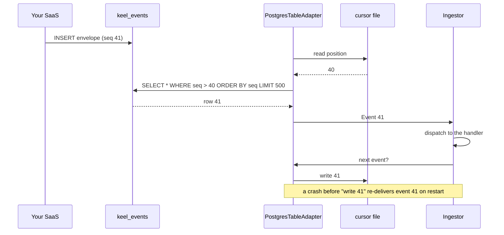

# Connect your events

Keel ingests envelopes, never raw rows. Every source produces the same shape, and the cartridge's handlers are the only code that reads a payload. Pick the source that matches where your events already are.

## The envelope

One event, as the development adapter reads it from `examples/events/fleet.jsonl`:

```json
{"tenant": "acme-logistics", "type": "unit.registered", "subject": "unit:MXK-4821",
 "occurred_at": "2026-09-01T09:00:00Z", "source": "fleet.vehicles",
 "payload": {"id": "MXK-4821", "plate": "MXK-4821", "model": "Freightliner Cascadia"}}
```

| Field | Required | Meaning |
| --- | --- | --- |
| `tenant` | yes | The end-customer this fact belongs to. Opaque to Keel. |
| `type` | yes | Dotted lowercase type from the cartridge catalog. |
| `subject` | yes | `<kind>:<id>` of the entity the fact is about. |
| `occurred_at` | yes | When it happened in the world. Timezone-aware. |
| `source` | yes | System of record or adapter name. |
| `id` | no | Generated when absent. Becomes the `evidence` of derived facts. |
| `recorded_at` | no | When Keel learned it. Defaults to now. |
| `payload` | no | Event data. Only handlers read it. |

The full rules are in the [specification](SPEC.md#2-event-envelope).

## A `.jsonl` file

For development and tests. One envelope per line; blank lines and lines starting with `#` are ignored.

```bash
uv run keel ingest cartridges/fleet examples/events/fleet.jsonl
```

## A Postgres outbox table

Your SaaS inserts envelopes into a table. Keel polls it in order and remembers the last row it took in a cursor file, so a restart resumes instead of re-ingesting.

```sql
CREATE TABLE keel_events (
    seq          bigserial PRIMARY KEY,
    id           text NOT NULL,
    tenant       text NOT NULL,
    type         text NOT NULL,
    subject      text NOT NULL,
    occurred_at  timestamptz NOT NULL,
    recorded_at  timestamptz NOT NULL DEFAULT now(),
    source       text NOT NULL,
    payload      jsonb NOT NULL DEFAULT '{}'
);
```

```bash
uv sync --extra postgres
```

```python
import psycopg

from keel import Ingestor, MemoryStore, SqliteStore, load_cartridge
from keel.adapters.postgres import PostgresTableAdapter

ingestor = Ingestor(load_cartridge("cartridges/fleet"), SqliteStore("keel.db"))  # durable; MemoryStore() for a throwaway graph
adapter = PostgresTableAdapter(lambda: psycopg.connect(DSN), table="keel_events", cursor_path=".keel/cursor")

ingestor.ingest(adapter)                      # one pass over everything after the cursor
ingestor.ingest(adapter.follow(interval=5))   # or poll forever
```

Delivery is at-least-once: the cursor advances after the consumer has taken an event, so a crash mid-event re-delivers it. The table name, the cursor column and the batch size are parameters. Any DB-API 2.0 connection works; pass `placeholder="?"` for sqlite3.



!!! warning "Concurrent writers"
    A serial cursor can skip a row that commits late while a later row was already read. Use one writer per table, or a `recorded_at` cursor with a lag, if that bites.

## A webhook

Keel receives envelopes over HTTP, validates them and ingests them in the request.

```bash
uv sync --extra webhook
```

```python
# app.py
from keel import Ingestor, MemoryStore, SqliteStore, load_cartridge
from keel.adapters.webhook import build_app

ingestor = Ingestor(load_cartridge("cartridges/fleet"), SqliteStore("keel.db"))  # durable; MemoryStore() for a throwaway graph
app = build_app(ingestor, token="shared-secret")
```

```bash
uv run uvicorn app:app --port 8000
curl -X POST localhost:8000/events \
  -H "Authorization: Bearer shared-secret" -H "Content-Type: application/json" \
  -d '[{"tenant": "acme-logistics", "type": "unit.registered", "subject": "unit:MXK-4821", "occurred_at": "2026-09-01T09:00:00Z", "source": "fleet.vehicles", "payload": {"id": "MXK-4821", "plate": "MXK-4821", "model": "Freightliner Cascadia"}}]'
```

The body is one envelope or a list. The response is the ingest report: `processed`, `unhandled` types and `errors`. A malformed envelope is a `422`; a wrong token is a `401`. Without a token the endpoint accepts any caller, so use that only on localhost.

## Consume a Kafka topic or an SQS queue

Your SaaS publishes envelopes as JSON messages; Keel consumes them. `uv sync --extra kafka` (confluent-kafka) or `--extra sqs` (boto3).

```python
from keel.adapters.bus import KafkaAdapter, SqsAdapter

adapter = KafkaAdapter.connect("broker:9092", topic="keel-events", group_id="keel")
adapter = SqsAdapter.connect("https://sqs.us-east-1.amazonaws.com/123456789012/keel-events")
ingestor.ingest(adapter)            # drain what is there now, then stop
ingestor.ingest(adapter.follow())   # consume forever
```

Delivery is at-least-once: the offset is committed, or the SQS message deleted, only after the handler ran, so a crash mid-event re-delivers it. A message that is not a valid envelope raises and stays on the bus; pass `dead_letter=lambda body, error: ...` to log it somewhere and move on. Both adapters only need two calls from their client (`poll`/`commit`, `receive_message`/`delete_message`), which is how the tests run them on fakes and how you would wrap another client.

## Serve the tools over MCP

```bash
uv sync --extra mcp
uv run keel serve cartridges/fleet --tenant acme-logistics --events examples/events/fleet.jsonl
```

With Claude Code, one command registers the server. The agent sees exactly five tools and nothing else:

```bash
claude mcp add keel -- uv run --directory $PWD keel serve cartridges/fleet --tenant acme-logistics --events examples/events/fleet.jsonl
```

With Codex CLI (OpenAI), declare the server in `~/.codex/config.toml`. Keel annotates `context`, `history`, `search` and `related` as read-only, so Codex runs them without asking even under `approval_policy = "never"`; `annotate` writes, so it prompts unless you set `default_tools_approval_mode = "auto"` on the server:

```toml
[mcp_servers.keel]
command = "uv"
args = ["run", "--directory", "/path/to/keel", "keel", "serve", "cartridges/fleet", "--tenant", "acme-logistics", "--events", "examples/events/fleet.jsonl"]
startup_timeout_sec = 60
```

A headless run, for a smoke test or CI:

```bash
codex exec --json "Which tires on unit:MXK-4821 are critical according to the cartridge's own rules? Use only the keel tools." < /dev/null
```

Checked on 2026-10-14 with Codex CLI 0.162 and `openai/gpt-5.2-codex` behind an OpenAI-compatible gateway: seven calls (`search`, `related`, `context`, `history` with `predicate=depth_mm`), the right tire, the right depth on 2026-09-20, and the threshold quoted from the cartridge rather than assumed. Any other MCP client works the same way: a stdio server, five tools, one tenant per server instance.

!!! note "Where is the graph stored?"
    In memory with `--events`: the server ingests the stream at start and serves it, which is enough for a demo. For a deployment, pass `--db keel.db` instead: a SQLite file (stdlib, WAL mode) that an ingest process fills while `keel serve` reads it.

    ```bash
    uv run keel ingest cartridges/fleet examples/events/fleet.jsonl --db keel.db   # or adapter.follow() in your own process
    uv run keel serve cartridges/fleet --tenant acme-logistics --db keel.db
    uv run keel replay cartridges/fleet examples/events/fleet.jsonl acme-logistics --db keel.db   # wipe one tenant, rebuild it from the log
    ```

    The log is the truth and the file is derived: `replay` rebuilds one tenant from the external log (your outbox table, your bus, a `.jsonl`) and never from the file itself. The store is pluggable: `SqliteStore` is the default, and any store that passes `tests/test_store.py` (see [contributing](contributing.md)) can take its place.

## Export the audit trail

One tenant, everything Keel knows about it, as JSONL: entities, relations and facts, closed ones included, each with `source`, `evidence`, `scope`, `recorded_at` and `corrected_by`. Hand it to the customer, an auditor, or a diff.

```bash
uv run keel export acme-logistics --db keel.db --out acme-logistics.jsonl
```

Each line is one record: `{"record": "fact", "subject": "tire:T-9001", "predicate": "depth_mm", "value": 5.2, "valid_from": ..., "valid_to": ..., "source": "tires.measurements", "evidence": "<event id>", ...}`. Another tenant's export never contains this one's rows.
