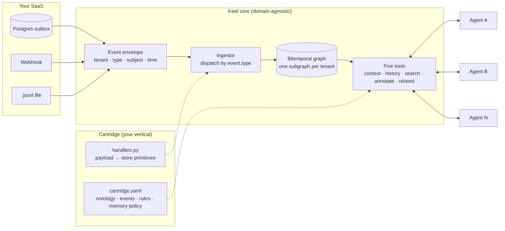

# Keel

**Stop rebuilding the pipeline for every agent.**

Keel is a context layer for AI agents inside vertical SaaS products. Domain events from your product go in. A bitemporal context graph per end-customer comes out. Every agent you build reads and writes it through the same five MCP tools.

You describe your vertical once, in a *cartridge*: ontology, event catalog, semantic rules, memory policies. Keel's core knows nothing about your domain. Your second agent connects in a day instead of weeks, because there is no second pipeline to write.

!!! note "Status"
    0.5.0, alpha. The MCP server, the Postgres table adapter and the webhook adapter run against the in-memory store, SQLite or MySQL (`--db`). See the [roadmap](roadmap.md).


## The problem

Every new agent in a SaaS product repeats the same work: extract the customer's data, normalize it, decide what "critical" means, keep its own memory, expose its own tools to the model. Four agents, four copies of the customer's context, four definitions of "critical", four memories that never talk.

Existing memory layers ingest text and documents and model memory per user or per agent. None of them start from **domain events**, and none model the **tenant of the tenant**: the end-customer of a B2B SaaS.

## How Keel is different

1. **Cartridges.** A vertical is declared in YAML plus a few ten-line handlers. The core stays generic. Write a cartridge for fleets, clinics, logistics, or your own product.
2. **Events in, not documents.** Keel ingests structured facts with time: Postgres tables, webhooks, Kafka later. Ingestion is deterministic and cheap. The graph is exact because it is born from events, not inferred from text.
3. **Every fact carries its provenance.** Source, `valid_from`, `valid_to`, `recorded_at`, and who corrected it. Audit-ready by construction.
4. **Tenant of the tenant.** One subgraph per end-customer, with its own permissions and expiry.

## Architecture



Events are the truth and the graph is derived, so one tenant's subgraph can be rebuilt by replaying its log. Agents never see a pipeline: they see five tools.

## Five tools, any agent

```text
context(subject, as_of?)                             -> what is true now, or at as_of: facts, relations, rules and their verdicts
history(subject, since?, until?, predicate?, scope?)  -> what was true, and when we learned it
search(text)                                         -> entities and facts matching text
annotate(subject, predicate, value, scope, evidence)  -> an agent (or a human) writes what it learned
related(subject, relation?)                          -> neighbors by relation type
```

Expose them over MCP with `keel serve` and point any agent framework at them. The names and signatures are part of the public standard; see the [specification](SPEC.md).

## Quick start

```bash
git clone https://github.com/angelkurten/keel && cd keel
uv sync --extra dev
uv run keel validate cartridges/fleet
uv run keel ingest cartridges/fleet examples/events/fleet.jsonl
uv run keel context cartridges/fleet examples/events/fleet.jsonl unit:MXK-4821
```

Then:

- [Your first cartridge in 20 minutes](first-cartridge.md): declare your own vertical.
- [Connect your events](connect.md): a Postgres outbox table, a webhook, or a `.jsonl` file, and the MCP server.
- [SDKs](sdks.md): a typed client generated from your cartridge (TypeScript today), the way protoc does.
- [Specification](SPEC.md): the normative contract for the envelope, the graph model, cartridges, tools and scopes.

## Design rules the core enforces

- **Events are the truth.** An append-only log. The graph is derived and can be replayed.
- **Pointers, not copies.** The graph holds references to your rows, the semantics, and earned memory. Never a copy of your tables.
- **Explicit time.** Facts close. They are not overwritten.
- **Scopes, not a flat store.** `global` > `tenant` > `task` > `agent`. Nothing is promoted to a wider scope by accident.
- **Five tools, and only five.** New capability goes into the semantics of the existing five.

## License

Apache 2.0. The event envelope, the cartridge format and the five tools are the standard. They will always be free.
