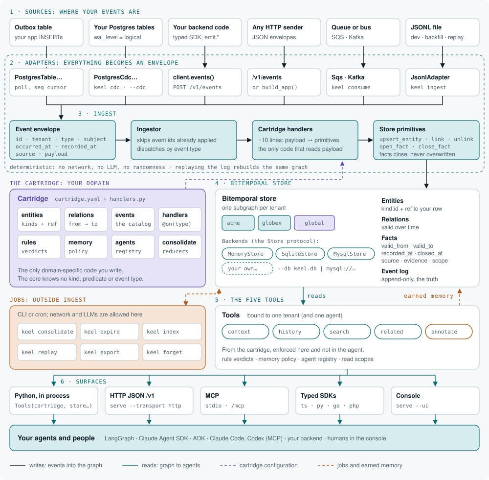

# Keel

**Stop rebuilding the pipeline for every agent.**

Keel is a context layer for the AI agents inside a product: a vertical SaaS, a consumer app, an internal tool. Domain events from your product go in. A bitemporal context graph per tenant comes out, whatever your unit is (an end-customer, a household, a team). Every agent you build reads and writes it through the same five tools, over MCP, HTTP or a typed SDK.

You describe your vertical once, in a *cartridge*: ontology, event catalog, semantic rules, memory policies. Keel's core knows nothing about your domain. Your second agent connects in a day instead of weeks, because there is no second pipeline to write.

!!! note "Status"
    0.30.2, alpha. Runs embedded in Python, as a container (`ghcr.io/angelkurten/keel`), or hosted during the pilots. See the [roadmap](roadmap.md).


!!! tip "Pilot it with us"
    Run Keel on your product's events with your agents, with our help: [your first pilot in a day](pilot.md). Open a [pilot request](https://github.com/angelkurten/keel/issues/new?template=pilot_request.yml), book 30 minutes at [calendar.app.google/3oKUSqXTQPYmjya56](https://calendar.app.google/3oKUSqXTQPYmjya56), or write to angel@angelkurten.com.

## The problem

Every new agent in a product repeats the same work: extract the customer's data, normalize it, decide what "critical" means, keep its own memory, expose its own tools to the model. Four agents, four copies of the customer's context, four definitions of "critical", four memories that never talk.

Existing memory layers ingest text and documents and model memory per user or per agent. None of them start from **domain events**, and none model the **tenant** your product already has: the end-customer of a B2B SaaS, the household of a consumer app, the team of an internal tool.

## How Keel is different

1. **Cartridges.** A vertical is declared in YAML plus a few ten-line handlers. The core stays generic. Write a cartridge for fleets, clinics, logistics, or your own product.
2. **Events in, not documents.** Keel ingests structured facts with time: your Postgres tables through CDC, an outbox, a typed SDK, webhooks, Kafka, SQS. Ingestion is deterministic and cheap. The graph is exact because it is born from events, not inferred from text.
3. **Every fact carries its provenance.** Source, `valid_from`, `valid_to`, `recorded_at`, and who corrected it. Audit-ready by construction.
4. **One graph per tenant.** One subgraph per end-customer, household or team, with its own permissions and expiry.

Keel is not an agent framework (your agents stay where they are), not a document memory (no LLM reads your events) and not a copy of your database (the graph holds pointers to your rows).

## Architecture



Events are the truth and the graph is derived, so one tenant's subgraph can be rebuilt by replaying its log. Agents never see a pipeline: they see five tools. [Architecture](architecture.md) walks through every box, with the options for each and when to pick which.

## Five tools, any agent

| Tool | The question it answers |
| --- | --- |
| `context` | What do I know about this subject now, or at a past moment? Open facts, relations and rule verdicts. |
| `history` | How did it change over time, and when did we learn it? |
| `search` | Which subjects match? By text, kind, rule, attribute value or meaning. |
| `related` | What is it connected to, up to three hops? |
| `annotate` | Remember what an agent or a person concluded, with evidence and a scope. |

The names and signatures are part of the public standard; every parameter is in the [specification](SPEC.md#7-the-five-tools).

## Quick start

```bash
git clone https://github.com/angelkurten/keel && cd keel
uv sync --extra dev
uv run keel validate examples/fleet --events examples/fleet/events.jsonl
uv run keel ingest examples/fleet examples/fleet/events.jsonl
uv run keel context examples/fleet examples/fleet/events.jsonl unit:MXK-4821
```

Then:

- [Architecture](architecture.md): the whole map, and your first day with Keel.
- [Your first cartridge in 20 minutes](first-cartridge.md): declare your own vertical.
- [Send your events](ingest.md): Postgres CDC, the typed SDK, an outbox table, a webhook, Kafka, SQS or a `.jsonl` file.
- [Serve the tools](serve.md): MCP, the HTTP JSON API, semantic search.
- [SDKs](sdks.md): a typed client generated from your cartridge (TypeScript, Python, Go, PHP), the way protoc does.
- [Operate](operate.md): configuration, the container, and the jobs to schedule.
- [Specification](SPEC.md): the normative contract for the envelope, the graph model, cartridges, tools and scopes.

## License

Apache 2.0. The event envelope, the cartridge format and the five tools are the standard. They will always be free.
